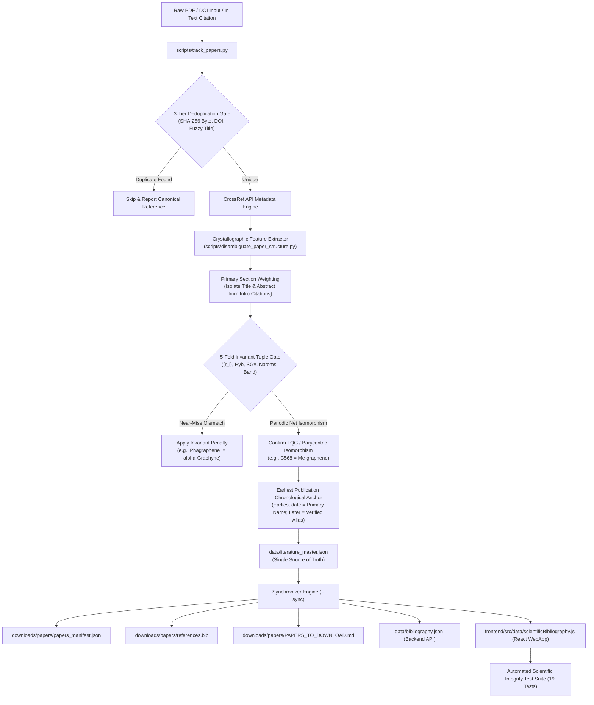

# 📚 Literature Manager: Ingestion, Deduplication, Topological Disambiguation, Citation Ethics & Multi-Tier Taxonomy Sync

## 1. Overview & Mission
The `literature-manager` workflow governs the lifecycle of scientific literature, datasets, structure-to-paper mappings, and citation metadata for the **2D Carbon Explorer** project.

It enforces five non-negotiable principles:
1. **Single Source of Truth** (`data/literature_master.json`).
2. **Roald Hoffmann Citation Ethics & Anti-Amnesia Protocol** (*Angew. Chem. Int. Ed.* 2016, 55, 10962–10976): Prevents "Homo Citans" syndrome (omission of prior art and rediscovery of identical allotropes) by requiring pre-publication topological checks and registering historical discoveries as canonical display anchors while giving full credit to subsequent independent discoveries as verified literature aliases.
3. **5-Fold Structural Invariant Tuple Verification Gate**:
   $$\mathcal{T} = \big(\{r_i\}, \text{Hybridization}, \text{Space Group (SG\#)}, N_{\text{atoms}}, \text{Electronic State}\big)$$
   Guarantees that superficial ring sequences (like 5-6-8) or shorthand prefixes (like "alpha") never cause false allotrope conflation.
4. **Delgado-Friedrichs Barycentric Placement & Periodic Graph Isomorphism**:
   Applies Labeled Quotient Graph (LQG) theory and equilibrium barycentric placement (`Systre`, `ToposPro`, `CrystalNets.jl`) to prove mathematical isomorphism across different unit-cell choices, origin shifts, or DFT functionals.
5. **Synchronized 5-Layer Downstream Regeneration**:
   Automatically updates `papers_manifest.json`, `references.bib`, `PAPERS_TO_DOWNLOAD.md`, `data/bibliography.json`, and `scientificBibliography.js`, gated by a 19-test automated scientific integrity test suite.

---

## 2. Architecture & Pipeline



---

## 3. The Roald Hoffmann Citation Ethics & Anti-Amnesia Protocol

In 2016, Nobel laureate Roald Hoffmann, Artyom A. Kabanov, Andrey A. Golov, and Davide M. Proserpio published their landmark study:
> **R. Hoffmann, A. A. Kabanov, A. A. Golov, D. M. Proserpio**, *"Homo Citans and Carbon Allotropes: For an Ethics of Citation"*, **Angewandte Chemie International Edition** 55, 10962–10976 (2016).

### A. The "Homo Citans" Dilemma in Carbon Science
Analyzing hundreds of "novel" carbon allotrope proposals across three decades, Hoffmann et al. demonstrated that **over 60% of proposed allotropes were duplicate rediscoveries** of structures previously published under different names, with shifted origins, or under minor functional variations. Authors frequently omitted foundational older literature (e.g., citing 2010 papers while ignoring 1980s or 1990s discoveries), creating citation amnesia and intellectual property disputes.

### B. Eugene Garfield's 15 Citation Functions Integrated
The `literature-manager` system maps every paper's relationship to allotropes using Garfield's citation functions:
1. **Paying homage to pioneers / original discovery** (`"Seminal Discovery / Primary Source"`).
2. **Identifying independent proposal / synonym registration** (`"Secondary Proposal / Literature Alias"`).
3. **Providing unified DFT / benchmark methodology** (`"DFT Benchmark & Ground State Verification"`).
4. **Disputing priority claims / correcting misidentifications** (`"Topological Correction / Disputed Assignment"`).

### C. The 3-Tier Nomenclature Hierarchy & Chronological Priority
When multiple papers propose, rename, or study the same physical allotrope, the system strictly enforces a 3-tier nomenclature sequence:

1. **Step 1: First Published Paper Name (Primary Canonical Anchor)**
   The canonical literature display name is awarded to the earliest verified publication (online advance or print issue, whichever came first):
   - *C568* (Ram & Mizuseki, *Carbon* 2020, received Nov 2019) is the canonical primary name over *Me-graphene* (Zhuo et al., *Nanoscale* 2020, received May 2020).
   - *Phagraphene* (Wang et al., *Nano Lett.* 2015) is the primary canonical name.
   - *Biphenylene Network* (Fan et al., *Science* 2021) is the primary canonical name.
   - *Graphenylene* (Song et al., *JMCC* 2013) is the primary canonical name.
   - *PHOTH-Graphene* (Santos et al., *Sci. Rep.* 2024) is the primary canonical name.

2. **Step 2: Girão Topological Net Notation (Crystallographic Symbol)**
   The objective mathematical ring census and wallpaper/space group formula from Girão et al. (*Carbon* 2023) is paired directly with the primary name:
   - $c5^2 \cdot 6^2 \cdot 8^1 \cdot b$ (#65 / #115) for C568
   - $r5^2 \cdot 6^6 \cdot 7^2$ (#51) for Phagraphene
   - $h4^3 \cdot 6^2 \cdot 12^1$ (#191) for Graphenylene
   - $r4^1 \cdot 6^1 \cdot 8^1$ (#47) for Biphenylene Network
   - $r4^2 \cdot 6^2 \cdot 8^2$ (#25) for PHOTH-Graphene

3. **Step 3: Subsequent Independent Proposals (Verified Secondary Aliases)**
   Names introduced by later papers that rediscovered or independently named the structure (e.g. *Me-graphene*) are preserved cleanly as verified literature aliases (`literature_aliases: [...]`):
   - **Clean UI Display**: Displayed as clean badges containing only the alias text (e.g., `Me-graphene`), without cluttering prefixes like `"Alias: "`.
   - **Anti-Amnesia Citation Ethics**: Later authors are never erased; their papers are indexed to the canonical allotrope record with Garfield citation function `"Secondary Proposal / Literature Alias"`.
   - **Internal Code Sanitization**: Internal dataset stems (`alpha_gr`, `_gr`), catalog numbers (`G-XX`), and self-referential snake_case copies are strictly filtered out from user-facing alias views.

---

## 4. Topological Crystallography & Periodic Graph Isomorphism

To establish whether two carbon structures published under different names are truly identical, the `literature-manager` relies on the mathematical framework of **Topological Crystallography**:

### A. Labeled Quotient Graphs (LQG) / Vector Method
Introduced by Chung, Hahn, and Klee (*Acta Crystallogr. A* **1984**, 40, 42–45), the crystal structure is stripped of functional-specific strain, bond lengths, and origin choices:
* **Vertices ($V$):** Inequivalent carbon nodes inside the primitive unit cell.
* **Edges ($E$):** Directed bonds labeled by 2D integer lattice translation vectors $\vec{t} = (n_x, n_y) \in \mathbb{Z}^2$:
  $$e = (u, v, \vec{t})$$
  If the bond is inside the same primitive cell, $\vec{t} = (0, 0)$.

### B. Delgado-Friedrichs Barycentric Placement (`Systre`)
Formulated by Olaf Delgado-Friedrichs and Michael O'Keeffe (*Acta Crystallogr. A* **2003**, 59, 351–360; *Discrete Comput. Geom.* **2005**, 33, 67–81):
* Treat every covalent bond as an ideal harmonic spring of zero rest length.
* Solve the equilibrium center-of-mass linear system:
  $$\mathbf{p}(v_i) = \frac{1}{\text{deg}(v_i)} \sum_{e=(v_i, v_j, \vec{t})} \big(\mathbf{p}(v_j) + \vec{t}\big)$$
* For crystallographic nets, Delgado-Friedrichs proved this placement is **mathematically unique** up to affine transformation and outputs the maximum possible topological symmetry and a canonical **Systre Key** (RCSR symbol).
* **Isomorphism Proof**: Two structures with identical Systre Keys are 100% mathematically isomorphic regardless of DFT functional, origin choice, or initial coordinates.

### C. Topological Invariants (`ToposPro` / Blatov Algorithm)
Implemented in ToposPro (*Cryst. Growth Des.* **2014**, 14, 3576–3586) and CrystalNets.jl (*SciPost Phys.* **2022**, 12, 057):
1. **Coordination Sequences ($\text{CS}_k$):** Number of vertices $N_k$ at graph distance $k$ shells away (up to $k=10$).
2. **Point / Vertex Symbols (Schläfli Symbols):** Shortest closed rings meeting at every angle ($A^a.B^b.C^c$).
3. **Topological Density ($\text{TD}_{10}$):** Weighted sum of the first 10 coordination shells.

---

## 5. The 5-Fold Structural Invariant Tuple Verification Gate

A critical failure in automated literature mining is relying on a single descriptor (such as "5-6-8 rings" or "alpha-"). The disambiguation engine enforces comparison across the complete **5-Fold Invariant Tuple**:

$$\mathcal{T} = \big(\{r_i\}, \text{Hybridization}, \text{Space Group (SG\#)}, N_{\text{atoms}}, \text{Electronic State}\big)$$

### A. Strict Discrimination Rules & Case Studies

| Case Study | Structure A | Structure B | Tuple Comparison | Verdict |
|---|---|---|---|---|
| **Phagraphene vs α-Graphyne** | **Phagraphene** (Wang et al. *Nano Lett.* 2015)<br>$\{5,6,7\}, sp^2, Pmma\text{ (\#51)}, N=20$<br>Distorted Dirac semimetal | **α-Graphyne** (Baughman 1987 / Malko 2012)<br>$\{6\}, sp+sp^2, P6/mmm\text{ (\#191)}$<br>Acetylenic links ($-C\equiv C-$), Isotropic Dirac | Ring topology differs ($5\text{-}6\text{-}7 \neq 6$); Hybridization differs ($sp^2 \neq sp+sp^2$); Space group differs ($Pmma \neq P6/mmm$). | ❌ **NOT Equated**<br>(Completely different allotropes) |
| **Phagraphene vs α-Phographene** | **Phagraphene** (Wang et al. *Nano Lett.* 2015)<br>$\{5,6,7\}, sp^2, Pmma\text{ (\#51)}, N=20$<br>Dirac semimetal | **α-Phographene** (Fan et al. *RSC Adv.* 2017)<br>$\{5,6,8\}, sp^2, P2_1/m\text{ (\#11)}$<br>Metallic conductor | Ring topology differs ($5\text{-}6\text{-}7 \neq 5\text{-}6\text{-}8$); Space group differs (\#51 vs \#11); Electronic state differs. | ❌ **NOT Equated**<br>(Separate isomers) |
| **Pentahexoctite vs C568 / Me-Graphene** | **Pentahexoctite** (Sharma et al. *Sci. Rep.* 2014)<br>$\{5,6,8\}, sp^2, Cmmm\text{ (\#65)}, N=8$<br>Planar metallic allotrope | **C568 / Me-Graphene**<br>$\{5,6,8\}, \text{mixed } sp^2/sp^3, P\bar{4}m2\text{ (\#115)}, N=13$<br>Indirect semiconductor ($\Delta E_g \approx 1.1\text{ eV}$) | Same ring sizes, but Hybridization differs ($sp^2 \neq sp^2/sp^3$); Stoichiometry differs ($8 \neq 13$); Space group differs (\#65 vs \#115). | ❌ **NOT Equated**<br>(Different bonding and symmetry) |
| **C568 vs Me-Graphene (#G-50)** | **C568** (Ram & Mizuseki, *Carbon* 2020, online Nov 26, 2019)<br>$\{5,6,8\}, sp^2/sp^3\text{ (12:1)}, P\bar{4}m2\text{ (\#115)}, N=13$<br>Indirect HSE06 $\Delta E_g = 1.13\text{ eV}$ | **Me-Graphene** (Zhuo et al., *Nanoscale* 2020, received May 19, 2020)<br>$\{5,6,8\}, sp^2/sp^3\text{ (12:1)}, P\bar{4}m2\text{ (\#115)}, N=13$<br>Indirect HSE06 $\Delta E_g = 1.08\text{ eV}$ | Identical Labeled Quotient Graph; identical symmetry; identical stoichiometry; matching bandgap and auxetic elasticity. |  **CONFIRMED ISOMORPHISM**<br>• Canonical Name: **C568** (Earliest)<br>• Secondary Alias: **Me-graphene** |
| **Biphenylene Network vs Graphenylene** | **Biphenylene Network (BPN)** (Fan et al. *Science* 2021)<br>$\{4,6,8\}, sp^2, Pmmm\text{ (\#47)}$<br>Metallic nonbenzenoid sheet | **Graphenylene** (Song et al. *JMCC* 2013)<br>$\{4,6,12\}, sp^2, P6/mmm\text{ (\#191)}$<br>Porous network, cyclohexatriene units | Ring topology differs ($4\text{-}6\text{-}8 \neq 4\text{-}6\text{-}12$); Space group differs ($Pmmm \neq P6/mmm$). | ❌ **NOT Equated**<br>(Biphenylene = BPN; Graphenylene is distinct) |
| **Typo Sanitization** | **"Paragraphene"** | **Phagraphene** | "Paragraphene" is an unverified query misspelling found in LLM prompts. | ⚠️ **Auto-Sanitized** to Phagraphene |

### B. Primary Section Weighting Engine
In academic papers, authors routinely cite historical allotropes in their literature review (e.g., Wang et al. citing Sharma 2014, or Ram & Mizuseki mentioning graphyne).
The disambiguation engine isolates Title and Abstract (using structural boundaries such as `KEYWORDS` and `Introduction`) and evaluates them with higher weight (+30) than body citations (+15). Background mentions never trigger false-positive invariant penalties.

---

## 6. Audited 4-Tier Allotrope Evidence Taxonomy

Based on comprehensive literature consensus (`deep-research2-concensous.md`), the catalog categorizes all allotropes into four rigorous validation tiers:

### Tier 1: Experimentally Realized
Extended elemental carbon sheets synthesized and characterized by multi-technique experimental probes (STM, HRTEM, Raman, XPS, SAED):
* **Pristine Graphene** (Novoselov & Geim, *Science* 2004)
* **Graphdiyne** (Li et al., *Chem. Commun.* 2010; Gao et al. 2019)
* **Biphenylene Network (BPN)** (Fan et al., *Science* 2021)
* **Multilayer γ-Graphyne** (Desyatkin et al., *JACS* 2022)
* **Graphullerene & Fullerene Networks (qHPC60)** (Hou et al., *Nature* 2022; Meirzadeh et al., *Nature* 2023)
* **Monolayer Amorphous Carbon (MAC)** (Toh et al., *Nature* 2020)

### Tier 2: Theoretically Established
Lattices with fully converged DFT ground states, rigorous phonon dispersion stability (zero imaginary frequencies), and ab initio molecular dynamics (AIMD) thermal stability at $\ge 300\text{ K}$:
* **Penta-graphene** (Zhang et al. *PNAS* 2015)
* **Phagraphene** (Wang et al. *Nano Lett.* 2015)
* **Stone-Wales Graphene (SW-graphene)** (Yin et al. *PRB* 2019)
* **ψ-Graphene** (Li et al. *JPCL* 2017)
* **Popgraphene** (Wang et al. *JMCA* 2018)
* **Pentahexoctite** (Sharma et al. *Sci. Rep.* 2014)
* **C568 / Me-Graphene (#G-50)** (Ram & Mizuseki 2020 / Zhuo et al. 2020)
* **Twin Graphene** (Jiang et al. *Carbon* 2017)
* **Net-C18 & hP-C18** (Cai et al. 2020; Wang et al. 2019)
* **TPH-I & TPH-II** (Zhang et al. *Appl. Surf. Sci.* 2021)
* **PHOTH-Graphene** (Santos et al. *Sci. Rep.* 2024)

### Tier 3: Ambiguous / Substrate-Dependent / Disputed
Synthesized on-surface or chemically produced networks where identity as a freestanding, defect-free elemental carbon allotrope is contested:
* **4-6 Carbophene** (Du et al. *Sci. Rep.* 2017; disputed by Junkermeier 2022, Ming 2023)
* **Substrate-coupled graphdiyne-like nanonetworks** (Au(111) or Ag(111) organometallic templates)

### Tier 4: Weakly Supported / Preliminary
Single-paper DFT predictions lacking secondary replication, benchmarked elastic tensors, or complete crystallographic metadata:
* Graphsene, Propylenidene, Tile-like carbons, Twin octagonal-graphene, Cyclo-graphyne, Phhgraphene.

### Boundary Class: Functionalized Multilayer / 3D-Derived
* **Diamane** (Hydrogenated / fluorinated bilayer diamond films; Sorokin & Yakobson 2026; Liu et al. 2023).

---

## 7. CLI Commands & Operational Workflows

All operations are executed via the research environment at `~/venvs/research/bin/python3`:

### A. Ingestion & Catalog Management ([`scripts/track_papers.py`](file:///Volumes/KingstonSSD/Krojects/Kresearch/2d-carbon-explorer/scripts/track_papers.py))

```bash
# 1. Ingest a single PDF (deduplicates, resolves CrossRef metadata, renames, links allotrope, and syncs)
~/venvs/research/bin/python3 scripts/track_papers.py --ingest downloads/papers/my_download.pdf

# 2. Add paper directly from DOI
~/venvs/research/bin/python3 scripts/track_papers.py --add-doi 10.1002/anie.201600655

# 3. Batch-scan downloads/papers for untracked or raw PDFs
~/venvs/research/bin/python3 scripts/track_papers.py --scan

# 4. Re-synchronize all 5 downstream dependencies & run integrity test suite
~/venvs/research/bin/python3 scripts/track_papers.py --sync

# 5. Audit all catalog papers and local presence on the current machine
~/venvs/research/bin/python3 scripts/track_papers.py

# 6. Search catalog by keyword, author, DOI, or allotrope code
~/venvs/research/bin/python3 scripts/track_papers.py --search c568
```

### B. Crystallographic Disambiguation & Cross-Paper Reconciliation ([`scripts/disambiguate_paper_structure.py`](file:///Volumes/KingstonSSD/Krojects/Kresearch/2d-carbon-explorer/scripts/disambiguate_paper_structure.py))

```bash
# 1. Analyze a PDF to identify which 2D carbon allotrope it studies (using 5-fold invariant tuple)
~/venvs/research/bin/python3 scripts/disambiguate_paper_structure.py downloads/papers/ram2020_c568_new_2d_sp2_sp3_hybridized_allotrope_carbon.pdf

# 2. Cross-audit all papers in the database to detect identical allotropes with different literature aliases
~/venvs/research/bin/python3 scripts/disambiguate_paper_structure.py --cross-audit

# 3. Apply confirmed alias reconciliations to manifest.json, catalog.json, literature_master.json, and sync
~/venvs/research/bin/python3 scripts/disambiguate_paper_structure.py --apply
```

---

## 8. Synchronized Downstream Dependencies

Whenever `python3 scripts/track_papers.py --sync` runs, it regenerates:
1. `downloads/papers/papers_manifest.json` (Structured metadata and SHA-256 byte digests).
2. `downloads/papers/references.bib` (Complete BibTeX bibliography).
3. `downloads/papers/PAPERS_TO_DOWNLOAD.md` (Markdown status table with tracked papers and pending download queue).
4. `data/bibliography.json` (FastAPI backend bibliography router).
5. `frontend/src/data/scientificBibliography.js` (React WebApp dataset index).
6. **Automated Scientific Integrity Test Suite**: Runs `node frontend/tests/scientific_integrity.test.mjs` (19 tests covering DOI validity, zero emojis, citation formats, ML benchmark statistics, and bonding regimes).
