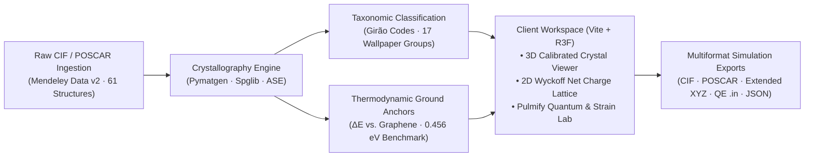

# 💎 2D Carbon Explorer · Carbon Atlas

> An elite, high-agency materials informatics platform bridging rapid visual discovery and strict first-principles thermodynamic viability for two-dimensional carbon allotropes.

<p align="center">
  
  
  
  
  
</p>

<p align="center">
  <a href="https://carlosraulps.github.io/2d-carbon-explorer/"></a>
  <a href="https://carlosraulps.github.io/resources/"></a>
</p>

---

## 1. The Platform Paradigm

In modern nanoscience, 2D carbon networks beyond graphene suffer from a pervasive **nomenclature crisis**: identical crystal geometries are repeatedly published under conflicting, disconnected synonyms (*biphenylene network* vs. *Net-W*, or conflicting variants of *phagraphene* and *pentaheptite*).

**2D Carbon Explorer (Carbon Atlas)** eliminates this ambiguity by uniting mathematical graph-theoretic taxonomy with first-principles electronic structure theory. It delivers hardware-accelerated 3D WebGL crystal inspection, live thermodynamic stability filtering against experimental synthesis benchmarks, and an interactive **Ab Initio Quantum & Strain Laboratory** powered by rigorous VASP 6.x DFT-D3, screened hybrid HSE06, and Henkelman Bader charge partitioning.

```
┌─────────────────────────────────┐      ┌──────────────────────────────┐      ┌───────────────────────────────┐
│     Design System & Tokens      │      │  WebGL Shader & 2D Lattice   │      │   Pymatgen / Spglib Engine    │
│  [Taste-Skill + Pulmify Rails]  │ ───> │  [React Three Fiber Canvas]  │ ───> │  [FastAPI / ASE / Exporters]  │
│  Monochrome Surfaces + Neon HUD │      │  Signed Bader Q_net Coloring │      │  Supercells (1×1 to 4×4)      │
└─────────────────────────────────┘      └──────────────────────────────┘      └───────────────────────────────┘
```

---

## 2. Core Architecture & Scientific Capabilities



### 2.1. Canonical Girão–Meunier Ring Topology & Macmillan Embedding Tensor $\Phi$

* **Rank-3 Integer Graph Embedding Tensor $\Phi$:** Introduces the coordinate-free algebraic tensor $\Phi$ elevating vertices, edges, and polygonal faces to equal footing, adhering to Euler characteristics $V - E + F = 0$ (Macmillan, Girão & Meunier, *npj Comput. Mater.* 11, 1932, 2025).
* **Exact Flag-Graph Wallpaper Group Identification:** Tolerance-free algebraic determination of the 17 plane symmetry groups ($p1$ through $p6mm$) directly from flag graphs, bypassing numerical tolerance ambiguities in Cartesian coordinates.
* **Mathematical Ring Invariant:** Every $sp^2$ network is classified via ring topology exponents ($h$, $r$, $c$, $t$ networks: $A = x\prod_{n} n^{a_n}$), providing collision-free identification regardless of literature synonyms.
* **Complete 61-Allotrope Master Dataset:** Full catalog spanning all 17 plane wallpaper groups and corresponding 3D space groups ($P1$ to $P6/mmm$) with rigorous slab geometry detection preserving in-plane coordinates across all crystal axes.

### 2.2. Thermodynamic Stability Anchors & Synthesis Feasibility

* **Reference Ground State:** Graphene monolayer calibrated to $\Delta E = 0.000\text{ eV/atom}$.
* **Biphenylene Synthetic Threshold:** Hard-coded visual anchor at $\Delta E = 0.456\text{ eV/atom}$ (Fan et al., *Science* 372, 2021). Structures below this boundary represent high-priority targets for on-surface chemical synthesis.

### 2.3. Pulmify Ab Initio Quantum & Strain Laboratory

A research-grade interactive instrument suite for candidate allotropes (benchmark: **PHOTH-Graphene**, $r4^1\cdot6^1\cdot8^1$ / `#25 Pmm2`):

* **Module 01: Charge Density Difference (CDD) Studio:** 2D basal planar slices ($z=0.50$) and 60-frame continuous breathing deformation loops ($\pm 3\%$ biaxial, armchair, and zigzag modes) evaluated via FFT augmentation grids ($160 \times 90 \times 440$).
* **Module 02: Electronic Band Laboratory:** High-symmetry $k$-path dispersion ($\Gamma - X - S - Y - \Gamma$) comparing semilocal GGA-PBE (semimetallic) vs. hybrid HSE06 screened exchange ($0.32\text{ eV}$ narrow gap), coupled with projected orbital DOS.
* **Module 03: Bader Charge Explorer:** Henkelman grid charge partitioning across inequivalent Wyckoff sites ($C_1$ to $C_6$) resolving site-specific electron depletion ($+q$, catalytic oxidation) and accumulation ($-q$).
* **Module 04: Hydrogen Evolution Reaction (HER) Studio:** Multi-site Volmer-Heyrovsky reaction profile ($\Delta G_{\mathrm{H*}}$). Biaxial tensile strain ($+2\%$) shifts site $C_1$ chemisorption from $+0.25\text{ eV}$ down to **$+0.08\text{ eV}$**, approaching ideal platinum-like kinetics.
* **Module 05: Strain & Breathing Simulator:** Live telemetry HUD tracking total energy, strain energy ($\Delta E_{\mathrm{strain}}$), and 2D harmonic elastic basin parameters ($c_{11}=261.2\text{ N/m}$, $c_{22}=257.1\text{ N/m}$, retaining $72\%$ of pristine graphene's stiffness).
* **Module 06: Calculation Provenance Hub:** Verifiable PAW POTCAR pseudopotential specifications with SHA-256 checksums, VASP `INCAR` / `KPOINTS` scripts, and raw CSV dataset downloads.

### 2.4. Interactive Atomistic Unit Cell Map

* Real-time in-plane SVG unit cell rendering with exact crystallographic bond connectivity.
* Atoms colored dynamically by their instantaneous signed Bader net charge $Q_{\mathrm{net}}(\varepsilon) = Z_{\mathrm{val}} - N_{\mathrm{Bader}}$ under user-controlled strain magnitude.

---

## 3. Technology Stack

| Layer | Technology | Primary Function |
| :--- | :--- | :--- |
| **Frontend Framework** | `Vite 5` + `React 18` | Ultra-fast client platform with client-side routing & proxying |
| **Styling & Design System** | `Tailwind CSS` + Vanilla CSS | Custom typographic tracking, editorial grid density, dark/light theme |
| **3D Crystal Canvas** | `React Three Fiber` + `Three.js` | WebGL hardware-accelerated periodic lattice rotation & orbit controls |
| **Micro-Interactions** | `Framer Motion` + `GSAP` | Zero-CLS layout animations, split-pane transitions, and scroll reveals |
| **Math & Scientific Typo** | `KaTeX` | Native LaTeX mathematical and crystallographic typesetting |
| **Compute Microservice** | `FastAPI` (Python 3.11+) | Async REST API for crystallography, symmetry search, and supercells |
| **Materials Modeling** | `Pymatgen` + `Spglib` + `ASE` | Spacegroup analysis, Wigner-Seitz cells, periodic boundary expansion |
| **Classical Visualizer** | `Dash` + `Crystal Toolkit` | Legacy dashboard companion with Plotly stability distributions |

---

## 4. Quick Start

### Prerequisites

- Node.js 18+ & npm
* Python 3.10+ (recommend `uv` or virtual environment at `~/venvs/research`)

### 4.1. Launch the Client Platform (React + Vite)

```bash
cd frontend
npm install
npm run dev
```

The interactive explorer will be live at `http://localhost:5173`.

### 4.2. Launch the Compute Microservice (FastAPI + Pymatgen)

```bash
# In project root
python -m venv .venv
source .venv/bin/activate
pip install -r requirements.txt
pip install -e backend/

# Start FastAPI backend on port 8000
uvicorn backend.app.main:app --host 127.0.0.1 --port 8000 --reload
```

The API docs will be accessible at `http://127.0.0.1:8000/docs`.

### 4.3. (Optional) Launch the Classical Dash Explorer

```bash
python app.py
# Accessible at http://127.0.0.1:8050
```

---

## 5. Advanced Simulation Exports & Supercells

The platform natively compiles multi-suite simulation inputs without manual terminal scripts:

* **CIF (`.cif`):** Standard crystallographic information format with authentic cell symmetry.
* **VASP POSCAR (`.vasp`):** Direct Cartesian/Direct coordinate translation with fixed vacuum spacing ($c > 16\text{ \AA}$).
* **Extended XYZ (`.xyz`):** Explicit periodic lattice vector definitions on comment line 2 (`Lattice="a1x a1y a1z ..."`).
* **Quantum ESPRESSO (`.in`):** Parameterized `&SYSTEM` namelists (`ibrav = 0`, `nat`, `ntyp = 1`, `ATOMIC_POSITIONS crystal`).
* **Cloud Schema (`.json`):** Standard JSON-LD representation aligned with Materials Project schema constraints.

### Programmatic Supercell Expansion Example

```python
from pymatgen.core import Structure
import numpy as np

def generate_target_supercell(cif_path: str, scale_matrix: tuple[int, int, int] = (2, 2, 1)) -> Structure:
    """
    Builds extended periodic boundaries for DFT surface relaxation,
    preserving 2D monolayer vacuum isolation.
    """
    primitive = Structure.from_file(cif_path)
    
    # Scale in-plane periodic vectors while maintaining c-axis vacuum
    scaling = np.diag(scale_matrix)
    supercell = primitive.make_supercell(scaling, in_place=False)
    
    return supercell
```

---

## 6. VASP Electronic Structure Grounding

All first-principles calculations in the Ab Initio Quantum Suite adhere to strict electronic convergence thresholds:

```fortran
! VASP Ground-State Relaxation Parameters (PHOTH-Graphene)
SYSTEM = PHOTH-Graphene Monolayer
PREC   = Accurate      ! Complex FFT grids for 2D sp2 carbon
ENCUT  = 800           ! Plane-wave kinetic energy cutoff (eV)
EDIFF  = 1E-8          ! Tight electronic self-consistency (eV)
EDIFFG = -0.001        ! Strict Hellmann-Feynman force tolerance (eV/Å)
ISIF   = 2             ! Relax atomic positions; keep c = 20 Å vacuum fixed
ISMEAR = 0 ; SIGMA = 0.01  ! Gaussian smearing for 0K energy
IVDW   = 11            ! Grimme DFT-D3 zero-damping dispersion
```

---

## 7. High-Agency UI Guardrails

Adhering to the [taste-skill](https://github.com/leonxlnx/taste-skill) framework:

* **Typography:** Tight character tracking (`tracking-tight`) with Google Outfit display typography paired with DM Mono technical telemetry.
* **Surface Hierarchy:** Deep forest and charcoal base layer tokens (`#0a1815`, `#0f2b23`) balanced by warm neutral parchment panels (`#f9f9f6`, `#ffffff`).
* **Signed Charge Continuum:** Monochromatic baseline accented with tactical terracotta/copper (`#c97b5d`, electron depletion $+q$) and deep emerald (`#1b4332`, electron accumulation $-q$).
* **Fluid Responsiveness:** Adaptive multi-pane layout calibrated for high-density 13-inch laptop displays, desktop workstations, and mobile devices.

---

## 8. Machine Learning Study & Scientific Reproducibility

The platform has been enhanced into a literature-linked scientific database to support peer-reviewed machine learning studies of 2D carbon allotropes.

### 8.1. Canonical Deduplication (53 vs 61 Allotropes)
* **Deduplication:** While the catalog contains 61 historical and literature entries, topological and crystallographic invariance proves that **only 53 are unique canonical structures**.
* **Compute Savings:** Training and evaluating exclusively on the 53 canonical allotropes eliminates **13.11%** of redundant ab initio compute and prevents memorization leakage.
* **Identity Mapping:** Duplicate aliases (e.g. `g-03` $\to$ `graphene`, `beta_gr` / `g-15` $\to$ `biphenylene`, `g-08` / `alpha_gr` $\to$ `phagraphene`) are formally cataloged with full bibliographic provenance.

### 8.2. Plane Standardization (Cyclic $SO(3)$ Rotation)
* **Vacuum Axis Normalization:** 12 structures originally lying perpendicular to $y$ (11) or $x$ (1) were rotated using cyclic right-handed $SO(3)$ rotation matrices ($\det(\mathbf{R}) = +1$).
* **Simulation Safety:** All 61 CIF structures in `data/structures/` are strictly $z$-normal with $c \ge 14.5$ Å, preventing unphysical vacuum collisions during DFT relaxations or 2D $k$-mesh evaluations.

### 8.3. Quantitative Geometric Descriptors & ML Export
* **Extracted Descriptors:** Planar area per atom, atomic density, in-plane aspect ratio $b/a$, bond-angle deviation $\mathrm{MSD}_{120}$, bond-length distributions, coordination fractions, ring size distributions ($f_4$ to $f_8$), and topological Shannon entropy $S_{\mathrm{ring}}$.
* **Reproducible Datasets:** Available in CSV and Parquet at `data/ml/carbon2d_ml_dataset.csv` and `data/ml/carbon2d_ml_dataset.parquet` with complete JSON feature schemas.
* **Leakage-Free Cross-Validation:** Baseline surrogate models (Ridge, Random Forest, Gradient Boosting) trained via `GroupKFold(n_splits=5, groups=crystal_system)` achieving MAE = 0.078 eV/atom on relative formation energies.
* **Full Documentation:** See [SCIENTIFIC_REPRODUCIBILITY.md](docs/SCIENTIFIC_REPRODUCIBILITY.md).

---

## 9. 📚 Scientific Grounding & Citations

If you utilize the 2D Carbon Explorer in your research, please cite:

```bibtex
@article{macmillan2025graph,
  title={Graph embedding tensor: unifying topological description, symmetry detection, and structure generation for two-dimensional carbon allotropes},
  author={Macmillan, Lilac and Gir{\~a}o, Eduardo Costa and Meunier, Vincent},
  journal={npj Computational Materials},
  volume={11},
  pages={1932},
  year={2025},
  publisher={Nature Publishing Group},
  doi={10.1038/s41524-025-01932-8}
}

@article{girao2023classification,
  title={Classification of $sp^2$-bonded carbon allotropes in two dimensions},
  author={Gir{\~a}o, Eduardo Costa and Liang, Liangbo and Rodrigues, Victor and Meunier, Vincent},
  journal={Carbon},
  volume={203},
  pages={611--619},
  year={2023},
  publisher={Elsevier},
  doi={10.1016/j.carbon.2022.11.077}
}

@article{wang2015phagraphene,
  title={Phagraphene: A Low-Energy Graphene Allotrope with Dirac Fermions},
  author={Wang, Zhen and Zhou, Xiang-Feng and Zhang, Xiaoming and Zhu, Qiang and Dong, Huafeng and Zhao, Mingwen and Oganov, Artem R.},
  journal={Nano Letters},
  volume={15},
  number={9},
  pages={6182--6186},
  year={2015},
  doi={10.1021/acs.nanolett.5b02512}
}

@article{fan2021biphenylene,
  title={Biphenylene network: A nonbenzenoid carbon allotrope},
  author={Fan, Qitang and Yan, Linghao and Tripp, Matthias W and Krej{\v{c}}{\'\i}, Ond{\v{r}}ej and Dimosthenous, Stamatis and Kachel, Stefan R and Chen, Mengyi and Foster, Adam S and Liljeroth, Peter and Gottfried, J Michael},
  journal={Science},
  volume={372},
  number={6544},
  pages={852--856},
  year={2021},
  publisher={American Association for the Advancement of Science},
  doi={10.1126/science.abg4509}
}

@article{jain2013commentary,
  title={Commentary: The Materials Project: A materials genome approach to accelerating materials innovation},
  author={Jain, Anubhav and Ong, Shyue Ping and Hautier, Geoffroy and Chen, Wei and Richards, William Davidson and Dacek, Stephen T and Cholia, Shreyas and Gunter, Dan and Skinner, David and Ceder, Gerbrand and Persson, Kristin A},
  journal={APL Materials},
  volume={1},
  number={1},
  pages={011002},
  year={2013},
  publisher={AIP Publishing},
  doi={10.1063/1.4812323}
}
```

---

## 10. Authors & Institutional Affiliation

- **Carlos R. Primo S.**
  - **GEEDAI** · Grupo de Estrutura Eletrônica e Dinâmica Atomística Interdisciplinar, Universidade Federal do ABC (UFABC), Santo André, SP, Brazil.
  - **GMCAN** · Grupo de Modelamiento Computacional de la Materia a Escala Nano, Universidad Nacional Mayor de San Marcos (UNMSM), Lima, Peru.

---

## 11. License

Distributed under the MIT License. See [LICENSE](LICENSE) for more information.
